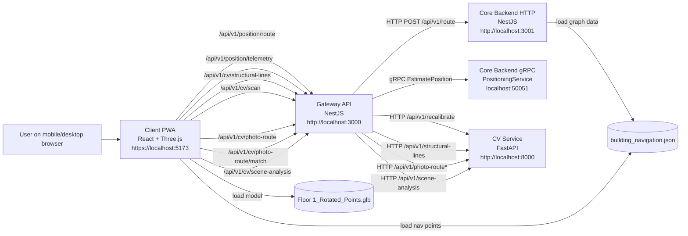
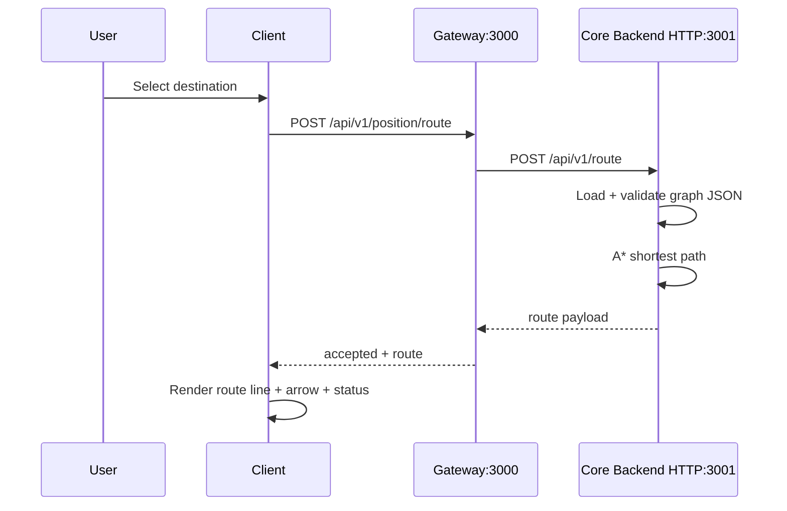
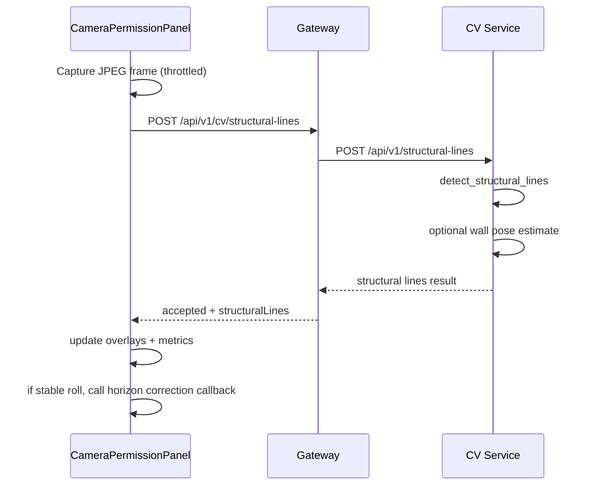
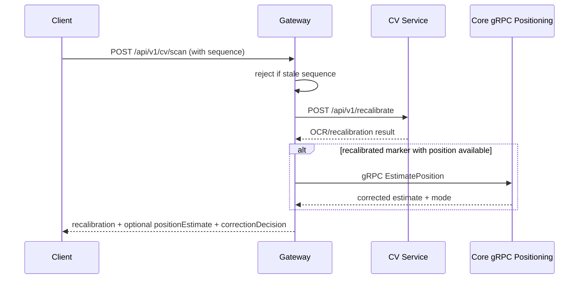
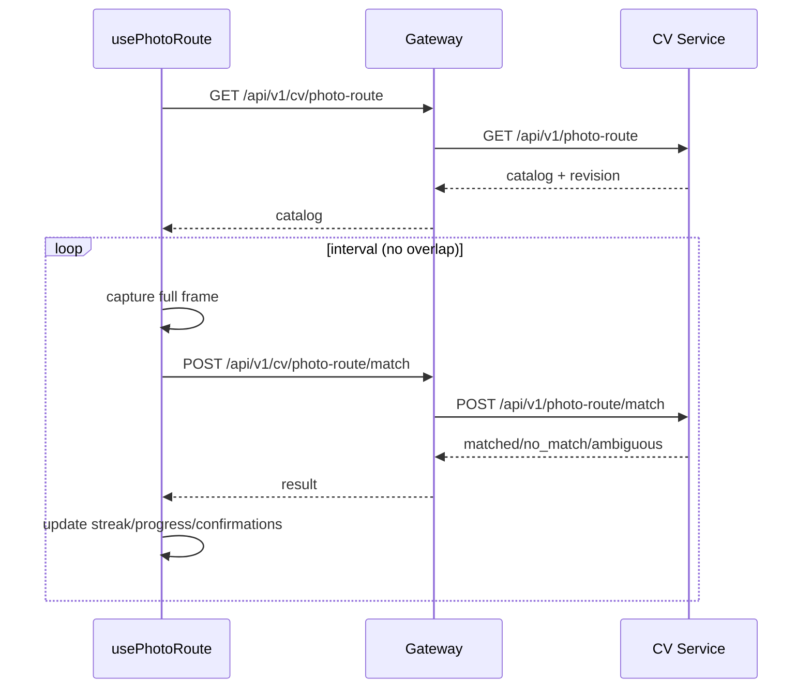

# NAV_AR Application Architecture

## 1. Overview

NAV_AR is a multi-service monorepo for indoor AR navigation that combines:

- A browser-based PWA client (React + Three.js)
- A NestJS API gateway
- A NestJS core backend (HTTP + gRPC)
- A Python FastAPI CV microservice

The system is designed for software-only indoor navigation experiments with optional camera-based diagnostics and matching.

Primary capabilities:

- Device motion/orientation driven camera and movement
- Graph-based route planning over building navigation JSON
- Optional floor/wall structural line detection from camera frames
- Optional photo-route matching against reference images
- Optional scene analysis (object + OCR text overlays)
- Telemetry and CV correction decision pipeline through gateway to gRPC position service

## 2. Runtime Topology and Ports

### 2.1 Default Local Endpoints

- Client (Vite HTTPS): https://localhost:5173
- Gateway (Nest HTTP): http://localhost:3000
- Core Backend HTTP (Nest): http://localhost:3001
- Core Backend gRPC: localhost:50051
- CV Service (FastAPI): http://localhost:8000
- CV Swagger: http://localhost:8000/docs

### 2.2 Service-to-Service Connections

- Browser client -> Gateway via same-origin `/api/*` proxy in Vite
- Gateway -> Core Backend HTTP at `CORE_BACKEND_URL` (default `http://localhost:3001`) for route API forwarding
- Gateway -> Core Backend gRPC at `CORE_BACKEND_GRPC_URL` (default `localhost:50051`) via `PositioningGrpcClient`
- Gateway -> CV Service at `CV_SERVICE_URL` (default `http://localhost:8000`) for CV endpoints
- Core Backend -> local proto file `proto/positioning.proto` for gRPC contract
- Core Backend graph loader -> `apps/client/public/building_navigation.json`

## 3. Startup and Process Orchestration

### 3.1 Root scripts

- `npm run start:dev:all`
  - Starts:
    - apps/core-backend (`start:dev`)
    - apps/gateway (`start:dev`)
    - apps/client (`vite dev --host`)
- `npm run start:dev:all:with-cv`
  - Runs `start-dev-all.sh`
  - Ensures Python venv and dependencies
  - Starts all four services, including CV service
- `npm run setup:cv-service`
  - Creates venv and installs CV dependencies
- `npm run start:cv`
  - Starts CV service only via uvicorn on port 8000

### 3.2 Client dev proxy

Vite dev server proxies `/api` to `http://localhost:3000`, so frontend fetches use relative `/api/...` and are routed through gateway in development.

## 4. High-Level Architecture Diagram (Mermaid)

## 5. Frontend Architecture (apps/client)

## 5.1 Core UI composition

Main screen composition in App.tsx:

- Three.js canvas with model and AR overlays
- Sensor control/menu panels
- Camera permission and CV processing panel
- Navigation status and compass widget

Primary scene components:

- `ModelScene` for GLB model rendering and model frame data
- `GyroCamera` for orientation-driven camera updates and movement modes
- `NavigationTracker` for player position tracking
- `NavigationRouteLine` for active route geometry
- `NavigationArrow` for directional guidance and distance HUD

### 5.2 Frontend state domains

- Sensor states: gyro, compass, acceleration permissions and live refs
- Movement calibration: thresholds, deadband, debounce, stride meters
- Navigation states: current point, active destination, active route, route message
- Camera CV states: camera permission, structural analysis toggles, scene/photo toggles
- Visualization states: model visibility, panel/menu open states, horizon offset correction

### 5.3 Hooks and responsibilities

- `useGyroscope`
  - Reads `DeviceOrientationEvent` and `DeviceMotionEvent`
  - Handles secure-context and iOS permission flow
  - Maintains orientation ref, motion ref, heading ref
  - Supports orientation and motion calibration offsets
  - Exposes `requestPermission`, `stop`, `calibrate`, `calibrateMotion`

- `useCompass`
  - Dedicated heading service separate from gyroscope
  - Reads compass from `webkitCompassHeading` when available, else absolute alpha fallback
  - Tracks source and accuracy metadata
  - Exposes `requestPermission`, `stop`

- `useAcceleration`
  - Reads devicemotion acceleration + gravity vectors
  - Computes high-pass vertical acceleration for step detection
  - Configurable thresholds/debounce/deadband via refs
  - Integrates velocity/position estimates for diagnostics
  - Exposes `requestPermission`, `stop`, `reset`

- `useNavigation`
  - Loads and validates `building_navigation.json`
  - Converts JSON points into world coordinates using `ModelScene` frame
  - Detects nearest/current navigation point
  - Computes/recomputes shortest path route via navigation graph utilities
  - Tracks route deviation and arrival conditions

- `usePhotoRoute`
  - Loads point references from gateway/CV
  - Captures periodic full-frame JPEGs
  - Sends match requests with thresholds
  - Maintains confirmation streak logic and progression through route points
  - Enforces no frame queueing (next tick only after current completes)

- `useSceneAnalysis`
  - Captures periodic JPEGs
  - Sends requests to scene-analysis endpoint
  - Handles timeout/abort and keeps latest snapshot
  - Enforces no overlapping frame requests

### 5.4 Navigation and transform details

- Navigation data source: `apps/client/public/building_navigation.json`
- `navigationPointToThreePosition` applies fixed alignment to map JSON coordinates to the normalized/recentered model frame
- Client routing uses shortest-path graph logic and cardinal directions
- `NavigationArrow` is camera-relative HUD-like 3D guidance with distance readout

### 5.5 Camera/CV panel behavior

`CameraPermissionPanel` handles:

- `getUserMedia` camera acquisition (rear camera preferred)
- Structural line analysis toggle
- Scene analysis toggle and confidence controls
- Photo route panel integration
- Throttled frame capture (structural 200ms interval)
- Abort and stale-protection behavior
- Optional horizon correction feedback from stable roll estimates
- Model visibility toggle integration (from parent state)

## 6. Gateway Architecture (apps/gateway)

### 6.1 Main responsibilities

- API aggregation and protocol translation layer
- REST ingress point for frontend `/api/v1/*`
- gRPC client for position estimation
- HTTP proxy/forwarder for CV microservice endpoints
- Validation/sanitization of incoming DTOs and settings ranges
- Lightweight sequence stale-frame rejection for CV scan pipeline

### 6.2 Modules

- `PositionModule`
  - Registers gRPC client package `positioning`
  - Exposes `PositionController`
  - Provides `PositioningGrpcClient`

- `CvModule`
  - Exposes `CvController`
  - Depends on `PositionModule` for gRPC callback to core positioning

- `WifiModule`
  - Exposes simple RSSI ingest endpoint (currently pass-through response)

### 6.3 Gateway endpoint map

- Position:
  - `POST /api/v1/position/route`
    - Forwards to core backend HTTP `/api/v1/route`
  - `POST /api/v1/position/telemetry`
    - Calls gRPC `EstimatePosition`

- CV:
  - `GET /api/v1/cv/photo-route?reload=true|false`
  - `POST /api/v1/cv/photo-route/match`
  - `POST /api/v1/cv/scene-analysis`
  - `POST /api/v1/cv/structural-lines`
  - `POST /api/v1/cv/scan`

- Wi-Fi:
  - `POST /api/v1/wifi/rssi`

### 6.4 Scan decision behavior in gateway

For `POST /api/v1/cv/scan`:

- Normalizes request payload aliases
- Rejects stale sequence frames per session (if sequence <= latest seen)
- Forwards to CV service recalibrate endpoint
- If CV returns recalibrated marker and marker_position:
  - calls core backend gRPC `EstimatePosition`
- Produces `correctionDecision` with mode/apply/reason/candidate distance

## 7. Core Backend Architecture (apps/core-backend)

### 7.1 Runtime interfaces

- HTTP server on port 3001
- gRPC microservice on port 50051 using `proto/positioning.proto`

### 7.2 Modules

- `GraphModule`
  - HTTP route computation API
  - Uses `GraphService`

- `PositioningModule`
  - gRPC `PositioningService.EstimatePosition` implementation

- `TrilaterationModule`
  - Placeholder for RSSI-based trilateration extension

- `DatabaseModule`
  - Provides `DatabaseService` and `PrismaService`

### 7.3 Graph routing pipeline

- Source of truth currently loaded from `apps/client/public/building_navigation.json`
- `DatabaseService.getGraphData()` parses/validates points and branches
- `GraphService` builds adjacency and executes A* shortest path
- Returns path, total distance, and expanded node details

### 7.4 Positioning gRPC pipeline

- Entry point: `PositioningGrpcController.estimatePosition`
- Delegates to `PositioningService.estimatePosition`
- Logic:
  - Validates required fields
  - If anchored CV marker with xyz is present:
    - passes candidate + estimated pose + confidence to `PositionCorrectionValidator`
    - returns hard_snap/soft_blend/reject decision details
  - Else falls back to simple heading + step-distance stub estimate

### 7.5 Correction gates

`PositionCorrectionValidator` rules include:

- Reject low OCR confidence (`< 0.45`)
- Reject invalid heading
- If no estimated pose: allow hard/soft based on confidence
- Reject candidate too far (`> 9m`)
- Hard snap when near and high confidence (radius <= 4m and confidence >= 0.8)
- Otherwise soft blend accepted

## 8. CV Service Architecture (apps/cv-service)

### 8.1 FastAPI endpoints

- `GET /health`
- `GET /api/v1/photo-route`
- `POST /api/v1/photo-route/match`
- `POST /api/v1/scene-analysis`
- `POST /api/v1/structural-lines`
- `POST /api/v1/recalibrate`
- `POST /scan` (compat wrapper)

### 8.2 Processing subsystems

- Structural geometry pipeline (`structural_lines.py`)
  - line segment extraction
  - floor boundary hypothesis generation and filtering
  - wall outline candidate extraction
  - roll estimate from vertical segments
  - pitch-aware wall detection skip gate

- Wall pose solver (`wall_pose.py`)
  - PnP-based camera pose estimation from detected wall outline + world wall corners
  - multiple solvePnP variants and candidate scoring
  - confidence score composition from visual and prior terms

- Photo route matcher (`route_photo_matching.py`)
  - route manifest + point references from `route_photos/route.json`
  - SIFT feature extraction and geometric verification
  - overlap/coverage/error checks
  - scoring and ambiguity handling

- Scene analysis (`scene_analysis.py`)
  - optional YOLOE object segmentation
  - optional Tesseract text extraction
  - partial/busy/unavailable statuses with timing metrics

- OCR recalibration (`main.py`)
  - preprocess + EasyOCR/Tesseract candidate extraction
  - currently returns ranked OCR candidates but no mapped marker_position by default
  - outputs optional horizon roll estimate

### 8.3 CV request constraints and behavior

- Base64 payload validation and decode checks
- Dimension constraints (for photo-route and scene-analysis)
- Non-queueing design in frontend hooks and panel
- Gateway timeout protections on forwarded requests

## 9. API Contract and Data Shapes

### 9.1 gRPC contract

Proto: `proto/positioning.proto`

- Service: `PositioningService`
- RPC: `EstimatePosition(EstimatePositionRequest) -> EstimatePositionResponse`
- Request includes:
  - device id, step count, heading
  - Wi-Fi RSSI list
  - CV markers list
  - optional estimated pose + confidence
  - frame sequencing and motion hints
- Response includes:
  - x, y, z, confidence, source
  - correction mode metadata

### 9.2 Primary REST contracts

- Route request:
  - `POST /api/v1/position/route`
  - body: `{ startNode, targetNode }`

- Telemetry request:
  - `POST /api/v1/position/telemetry`
  - body includes steps/heading/wifi/cv/pose/frame metadata

- Structural lines request:
  - `POST /api/v1/cv/structural-lines`
  - image payload + optional device pitch/roll + optional wall/camera metadata

- CV scan request:
  - `POST /api/v1/cv/scan`
  - image payload + optional estimated pose + heading + sequencing

- Photo route match request:
  - `POST /api/v1/cv/photo-route/match`
  - image payload + expected point + revision + thresholds

- Scene analysis request:
  - `POST /api/v1/cv/scene-analysis`
  - image payload + confidence threshold + include_text flag

## 10. End-to-End Flow Diagrams (Mermaid)

### 10.1 Route computation flow

### 10.2 Structural lines and roll correction flow

### 10.3 CV scan with correction decision flow

### 10.4 Photo route flow

## 11. Config and Environment Variables

- Gateway
  - `PORT` default `3000`
  - `CV_SERVICE_URL` default `http://localhost:8000`
  - `CORE_BACKEND_URL` default `http://localhost:3001`
  - `CORE_BACKEND_GRPC_URL` default `localhost:50051`
  - `POSITIONING_PROTO_PATH` optional override

- Core backend
  - `PORT` default `3001`
  - `POSITIONING_GRPC_URL` default `0.0.0.0:50051`
  - `POSITIONING_PROTO_PATH` optional override

- CV service
  - `CV_ROUTE_PHOTOS_DIR` optional references location
  - `CV_SCENE_MODEL_PATH` optional scene model path
  - `CV_SCENE_THREADS` optional thread cap

## 12. Assets and Shared Data

- GLB model:
  - `apps/client/public/Floor 1_Rotated_Points.glb`
- Navigation graph JSON:
  - `apps/client/public/building_navigation.json`
- Optional wall references:
  - `apps/client/public/wall_references.json`
- Photo-route references:
  - `apps/cv-service/route_photos/`
- Proto contract:
  - `proto/positioning.proto`

## 13. Reliability, Performance, and Concurrency Design

- Frontend avoids request queueing for camera frame loops
- AbortController used to cancel stale/overlapping operations
- Gateway applies frame sequence stale filtering by session for `/cv/scan`
- CV scene analyzer uses lock and busy response to prevent concurrent heavy inference
- Structural-line processing and photo-route include strict validation and bounded payload sizes

## 14. Current Architectural Constraints and Notes

- Core positioning remains partly stubbed for non-CV marker estimation path
- OCR recalibration currently returns text candidates and horizon roll, but marker mapping is not yet complete by default
- Wall-pose path is diagnostic-focused and gated by phone pitch and available references/intrinsics
- Graph source of truth is currently JSON in client public assets, not live DB tables
- Prisma schema exists but graph runtime currently uses JSON loader via `DatabaseService`

## 15. Suggested Flowchart Sections for Presentation

Use the Mermaid blocks above as direct inputs for diagrams. For presentation, build separate charts for:

- System Context (all services + ports)
- Route planning request flow
- CV structural-line flow
- CV scan correction decision flow
- Photo-route progression flow

This separation keeps complex behavior readable while preserving technical correctness.
